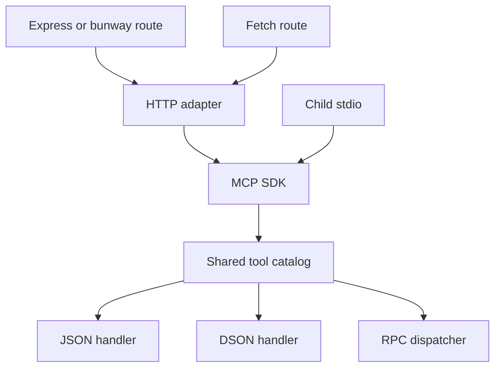

# Architecture

The public package registers application functions as MCP tools. Its HTTP adapter and stdio adapter share one registry. Protocol negotiation, envelope validation, JSON-RPC errors and SSE framing belong to the official TypeScript SDK. The package splits stdio input into lines itself, because the SDK's reader copies its whole buffer on every chunk; the [source boundaries](src/ARCH.md) give the measurement. The package registers only the tools capability. See the [source boundaries](src/ARCH.md).

VERIFIED: Each new SDK server instance receives the same catalog and startup-compiled validators. HTTP creates a fresh SDK server per request and stdio pins a server to its connection. Request headers and cancellation signals stay in call context. Tests exercise concurrent clients with separate headers.

The host starts and stops the listener. The HTTP adapter validates destination and origin, then delegates authentication to the host callback. Raw headers can include credentials and stay in the request context. Generic tool faults avoid exposing stack traces. The RPC bridge re-enters the registered dispatcher so RPC method guards also apply to MCP requests.

A loopback call through the bridge incurs RPC serialization and dispatch inside the MCP call. A tool registered directly can call the same implementation without that step. The benchmark measures both paths with the same addition function.

A direct function registry resolves methods once, preserves the object receiver, and publishes its binding keys in MCP discovery metadata. TypeScript callers import the server contract with a type-only import. Standard clients use the advertised positional schema.

The binary API carries canonical base64 in standard tool argument and result objects. Direct clients negotiate a compact tree representation per tool. Registry-local schema compilers reuse the process-level built-in meta-schema checks.

Tool observers wrap the shared dispatcher when configured. Tool processors run after wire decoding and before encoding. Hosts control log output, retention and backpressure. HTTP access decisions run before tool observation.

Tool metadata (title, description and annotations) passes into the frozen catalog unchanged. The registry copies annotation objects at registration, so later mutation by the application does not alter `tools/list`. A metadata key that names no registered function fails registration, since a misspelled key would otherwise drop a destructive-operation hint without a signal. A JSON tool's output schema is wrapped under `value`, the field that carries every JSON result, and the registry's compiler checks results against it.

The core, the typed client and the Fetch endpoint depend on web-standard APIs only. The HTTP entry imports its Node adapters on the first `middleware` call instead of shipping them as a separate entry point. Why: Express and bunway users keep the one `createMcpHttp` endpoint, while a Fetch host loads no Node module. VERIFIED: `scripts/compare.ts` times a fresh process importing the index and HTTP entries against v0.4.0; `validation/comparison.md` lists the result. The cost moves to the first Node request. Base64 uses `Buffer` when the runtime has it and web-standard methods otherwise. VERIFIED: Node 24.22.3 lacks `Uint8Array.prototype.toBase64`, so Node and Bun keep the native `Buffer` codec, and the website demo runs the published build in browsers.

Generated contracts bind to function identity in a realm-local weak map. The same public schema drives direct calls and the RPC bridge. Only the build-time executable imports TypeScript.

## Operations

Bun is the package manager and runs the examples, the verification scripts and the unit suite. The published library stays plain ESM and CommonJS so Node applications need no TypeScript loader. `make verify` runs lint, the suite on Bun, the suite again on Node with coverage, and the packed-consumer matrix. The VAE gate adds a check that the matrix evidence covers every supported client and came from the current tarball. See the [verification drivers](scripts/ARCH.md).
