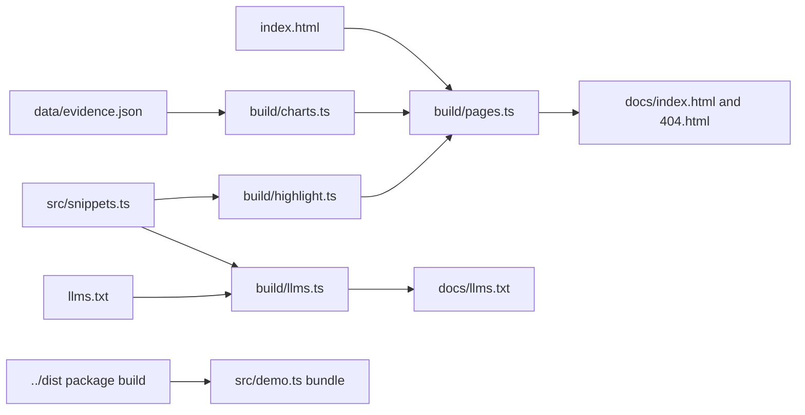

# Website architecture

## Purpose

The site shows what defuss-mcp does by running it. Its demo registers four tools in the page, mounts `createMcpHttp`, and connects the official MCP TypeScript client through a transport whose `fetch` calls `endpoint.fetch` directly. It is a static site without server code.

## Build

Why bundle `../dist` instead of the sources: the demo then runs the files a release ships. VERIFIED: (site e2e) the Vite aliases resolve `defuss-mcp`, `defuss-mcp/http`, `defuss-mcp/client` and `defuss-mcp/validation` to `dist/`, and the demo binds the generated `examples/math.mcp.ts`.

Why HTML bar charts rendered at build time instead of a chart library: the page ships no chart code, the figures read without JavaScript, theme colours apply through CSS tokens, and labels keep the page's text size at every width. VERIFIED: (screenshots) an SVG viewBox scaled its labels with the card width, which HTML bars avoid.

Why a committed evidence snapshot instead of reading `output/` during the build: `output/` is gitignored run output, while the site must build in a fresh checkout and in CI. `bun scripts/site-data.ts` copies the figures from one `make verify` and `make bench` run and refuses evidence of different tarballs. The VAE rule `site.evidence-version` fails when the snapshot describes another package version.

The build writes into `docs/`, where the package's Markdown pages also live, so Vite keeps the folder and `build/pages.ts` removes only the files it owns before writing. The package publishes `docs/*.md` only.

## Runtime

`src/main.ts` loads defuss-shadcn per component instead of its all-in-one bundle, then the theme and install controls. The demo module loads when the demo section comes within 400 pixels of the viewport. VERIFIED: (vite build) the demo chunk holds the MCP SDK client and server, Ajv and defuss-dson, about 185 kB gzipped. The Node adapter of `defuss-mcp/http` becomes a separate chunk that the page never requests.

## Operations, security and privacy

The page makes no network request outside its own origin: fonts are bundled, and the demo's HTTP exchanges stay inside the page. VERIFIED: (site e2e, three engines) the suite fails on any request outside the local server, on page errors and on console errors. The theme choice is the only stored value, in `localStorage` under `mcp-theme`.

`build/pages.ts` holds the two addresses the page links to: `ORIGIN` (`https://mcp.defuss.org`) for the canonical link, the sitemap and llms.txt, and `REPO_URL` (`https://github.com/kyr0/defuss-mcp`) for source links. Change those constants when the site or the repository moves.
